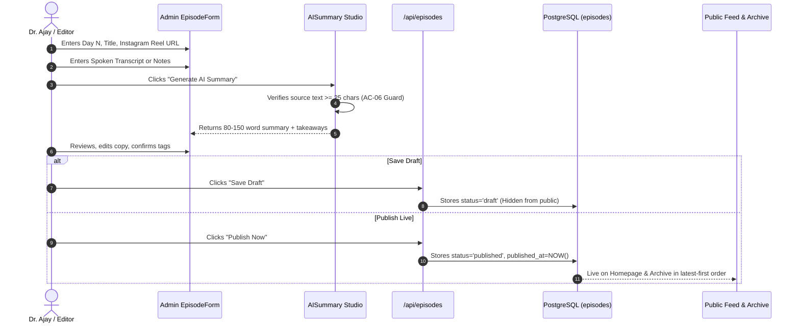
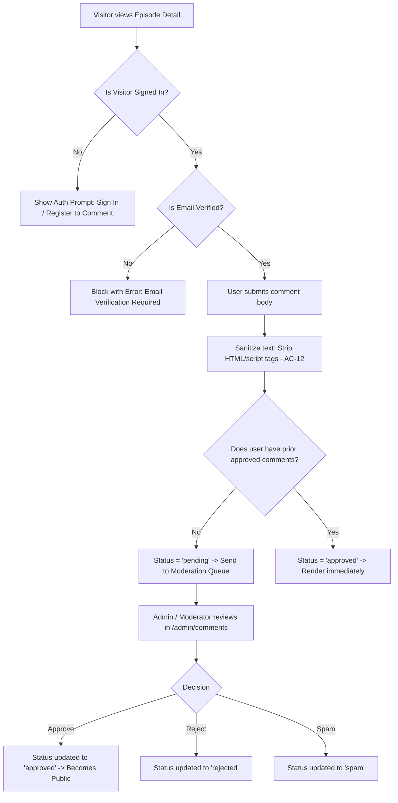
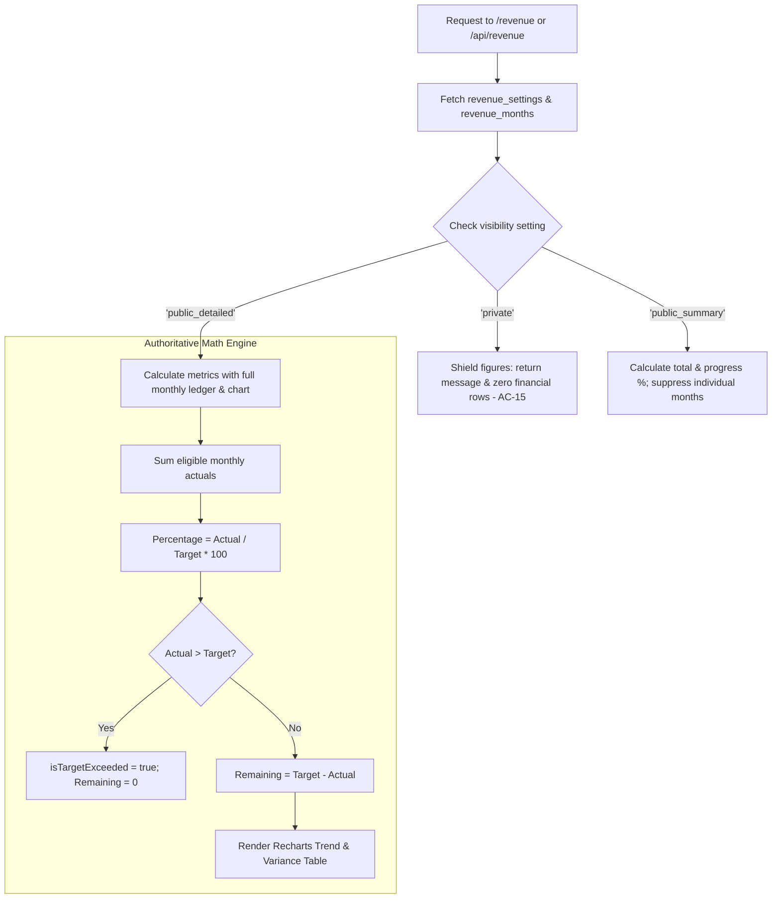

# PROJECT DHURANDHAR — FEATURE FLOW MAP
**Application:** Project Dhurandhar — Road to ₹30CR Revenue  
**Target:** `https://projectdhurandhar.automationlabs.online`  
**Architecture:** Next.js 14 App Router + PostgreSQL (Supabase) + Server AI  

---

## 1. Episode Creation to Publication Lifecycle



---

## 2. Community Comments & Moderation Queue Flow



---

## 3. Revenue Dashboard Calculation & Privacy Flow



---

## 4. Search & Content Taxonomy Flow

```mermaid
flowchart LR
    User[Visitor Enters Search Query] --> Query[/api/episodes?q=...]
    Query --> Filter[Filter published episodes only]
    Filter --> Match[Match Day N, Title, Summary, or Tag]
    Match --> Sort[Sort by published_at DESC, day_number DESC]
    Sort --> UI[Display lightweight cards on Archive Page]
```
