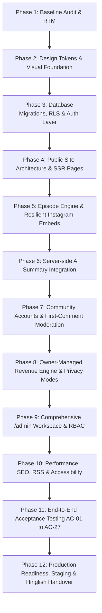

# PROJECT DHURANDHAR — IMPLEMENTATION PLAN
**Document Version:** 1.0.0  
**Date:** 11 October 2026  
**Target:** Production-Grade Custom Web Application for Project Dhurandhar  
**Reference Document:** `Project_Dhurandhar_Road_to_30CR_Custom_Website_Developer_Specification.pdf`  
**Production URL:** `https://projectdhurandhar.automationlabs.online`

---

## 1. Phased Architecture & Execution Roadmap

To guarantee stability, zero regressions, and complete fulfillment of all 27 acceptance criteria, the implementation is partitioned into 12 coherent, test-driven phases.

---

## 2. Phase-by-Phase Breakdown

### Phase 1: Baseline Audit, Repository & RTM Setup (Completed)
- Inspect environment (Node v24, npm 11, git).
- Create `PROJECT_AUDIT.md`, `REQUIREMENTS_TRACEABILITY.md`, `IMPLEMENTATION_PLAN.md`.
- Scaffolding Next.js App Router with TypeScript and Tailwind CSS.
- Ensure strict DNS preservation rules for parent domain `automationlabs.online`.

### Phase 2: Design Tokens, Typography & Component System
- Create `DESIGN_SYSTEM.md` and define CSS variables:
  - Base: Deep Navy (`#0b0f17`, `#0f172a`, `#1e293b`)
  - Content: Crisp Warm White (`#f8fafc`, `#ffffff`)
  - Actions: Electric Blue / Cyan (`#0284c7`, `#0ea5e9`, `#06b6d4`)
  - Accents: Restrained Gold (`#f59e0b`, `#d97706`, `#b45309`)
- Configure Tailwind CSS tokens (`colors`, `fonts`, `radii`, `focus-rings`).
- Implement core UI primitives:
  - Accessible Buttons, Badges, TextInputs, TextAreas, Modals, Breadcrumbs, Empty States, Skeletons.
- Validate focus rings (`focus-visible:ring-2 focus-visible:ring-sky-500`) and WCAG AAA/AA contrast.

### Phase 3: Database Architecture, Migrations & RLS Policies
- Create `supabase/migrations/001_initial_schema.sql`:
  - 13 tables: `profiles`, `episodes`, `tags`, `episode_tags`, `people`, `companies`, `episode_people`, `episode_companies`, `comments`, `revenue_settings`, `revenue_months`, `revenue_milestones`, `audit_log`, `ai_jobs`, `slug_redirects`.
- Write rigorous Row Level Security (RLS) policies for anonymous visitors, authenticated members, moderators, editors, and admins.
- Configure client abstraction:
  - Dual-mode data access layer: Live Supabase client (when credentials configured) + In-memory mock/local database repository with identical query contracts (so all tests and previews work reliably out-of-the-box).

### Phase 4: Public Site Pages & Layouts (SSR & SEO)
- Layout: Responsive navbar with "Watch Latest" CTA and clean mobile drawer.
- Homepage (`/`):
  1. Header with brand identity
  2. Hero with bold statement: *"Building towards ₹30 crore. One day at a time."*
  3. Real-time revenue progress snapshot widget
  4. Latest episode featured spotlight with video embed fallback
  5. Episode grid (descending published order, preview cards without bloated iframe loading)
  6. Milestones timeline
  7. "What this journey covers" topics
  8. Community invitation CTA
  9. Editorial footer with disclaimer and legal routes
- Public pages:
  - `/episodes` (Searchable, filterable archive with tag pills, date filter, pagination)
  - `/episodes/[slug]` (Full episode detail, summary, key takeaways, collapse transcript, navigation, share links)
  - `/revenue` (Detailed dashboard, charts, monthly target vs actual, milestones, audit disclaimer)
  - `/about` (Founder background, company mission, transparent methodology)
  - `/community-guidelines`, `/privacy`, `/terms`
  - `/sign-in`, `/register`

### Phase 5: Episode Engine & Resilient Instagram Embeds
- Validation utility: Strict checking for valid Instagram permalinks (`instagram.com/p/*`, `instagram.com/reel/*`), stripping tracking query parameters (`utm_*`, `igsh`, etc.).
- Embedded video player with client-side error detection: If Instagram iframe blocks or times out, immediately render high-trust fallback badge: *"Watch on Instagram (Opens in new tab)"* with pristine styling.
- Slug stability engine: Updating title does NOT change slug unless explicitly opted in. Old slug is automatically archived in `slug_redirects`.

### Phase 6: Server-Side AI Summary Integration
- Configurable AI service (`src/lib/ai/provider.ts`):
  - Model provider abstraction supporting Google Gemini, OpenAI, Anthropic, or Groq.
  - Strict input boundary: Requires transcript, caption, or admin notes. Rejects empty URL-only requests with descriptive error message (satisfies AC-06).
  - Generates: Neutral editorial summary (80–150 words), 3–7 key bullet takeaways, suggested tags, and SEO meta description.
  - Safe regeneration guard: Dialog prompting user before overwriting existing text (satisfies AC-07).
  - Saves always as draft; zero automatic publishing (satisfies AC-05).

### Phase 7: Community Accounts & Comment Moderation
- Supabase Auth integration: Sign up, email verification check, sign in, sign out, password reset.
- Comments workflow:
  - Gated to authenticated and email-verified users (AC-09, AC-10).
  - First-time moderation: If user has 0 prior approved comments, comment status is automatically set to `pending` and placed in moderation queue (AC-11).
  - Security: Strip scripts, HTML tags, and sanitize body with DOMPurify/custom escape engine (AC-12).
  - Privacy: Author email is strictly kept in secure profile table; only public display name is ever rendered.

### Phase 8: Owner-Managed Revenue Engine
- Math calculation engine (`src/lib/revenue/calculator.ts`):
  - Authoritative calculation from database rows.
  - Indian numbering formatting (`₹X.XX Cr`, `₹X.XX L`, `₹X,XX,XXX`).
  - Supports Cumulative vs Financial Year periods.
  - Supports Recognised, Invoiced, or Cash Collected basis.
  - GST treatment note (Included vs Excluded).
  - 3 visibility modes: `public_detailed`, `public_summary`, `private`.
  - Edge cases handled: 0 revenue, below target, exactly at target, above target ("Target exceeded"), missing months ("Not entered").
  - CSV export for authorized owner.

### Phase 9: Comprehensive /admin Workspace
- Full suite of management screens:
  - `/admin`: Metrics overview, draft count, pending comments, AI logs, revenue status.
  - `/admin/episodes`: List, filter, search, quick edit, status toggles.
  - `/admin/episodes/new` & `[id]`: Full editor with live preview, AI generation widget, tag selector, people/companies association.
  - `/admin/comments`: Pending, approved, spam, rejected tabs with one-click actions.
  - `/admin/revenue`: Monthly actual/target entry, visibility toggle, audit history.
  - `/admin/members`: Member management and role assignments.
  - `/admin/settings`: Site configuration, timezone, AI budget/model, email provider.
  - `/admin/audit-logs`: Chronological log of administrative actions.

### Phase 10: Performance, SEO, RSS & Accessibility
- Metadata API: Dynamic OpenGraph images, titles, descriptions, canonical URLs.
- XML Sitemap (`/sitemap.xml`) and RSS Feed (`/feed.xml`).
- Staging headers: `X-Robots-Tag: noindex, nofollow` on non-production hosts.
- Full keyboard navigation, ARIA attributes, semantic headings.

### Phase 11: End-to-End Verification & Acceptance Testing (AC-01 to AC-27)
- Automated test scripts covering every single acceptance criterion.
- Documented execution results in `TEST_RESULTS.md`.

### Phase 12: Documentation, Walkthrough & Owner Handover
- `OWNER_CONFIGURATION_CHECKLIST.md`
- `DEPLOYMENT_RUNBOOK.md`
- `HINGLISH_PROJECT_WALKTHROUGH.md`
- `FEATURE_FLOW_MAP.md`
